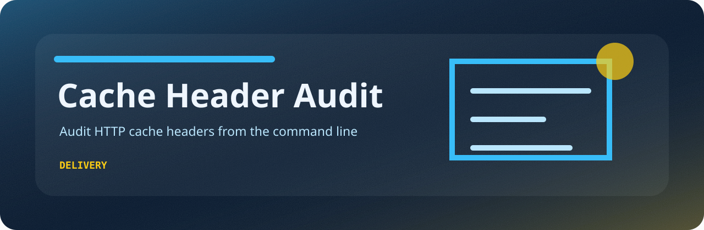
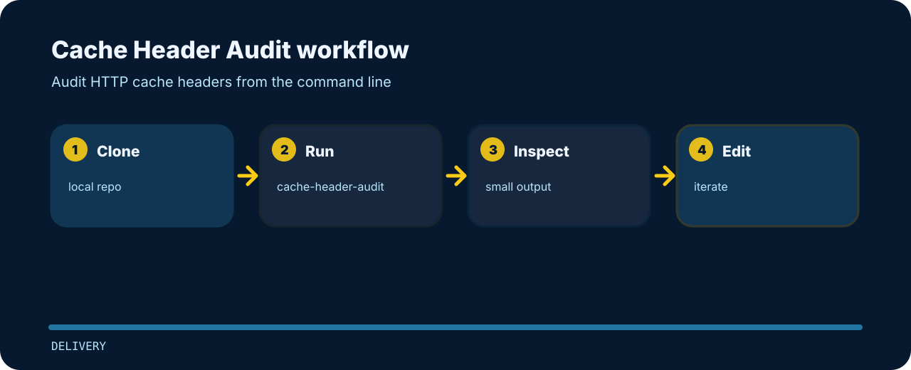

# Cache Header Audit

Cache Header Audit focuses on one practical job in delivery. The README below is arranged around the shortest path from clone to result.



## Open these first

```text
src/            package source
tests/          test coverage
.gitignore      project file
pyproject.toml  package metadata
```

## Try the sample

```bash
git clone https://github.com/mertefekurt/cache-header-audit.git
cd cache-header-audit
python -m pip install -e ".[dev]"
cache-header-audit --help
```

## How it runs


